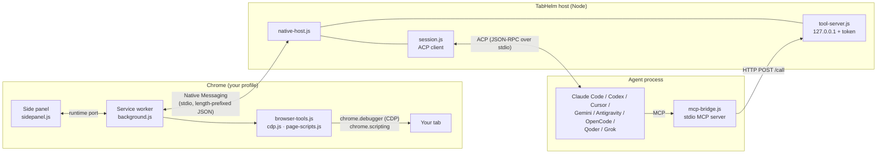
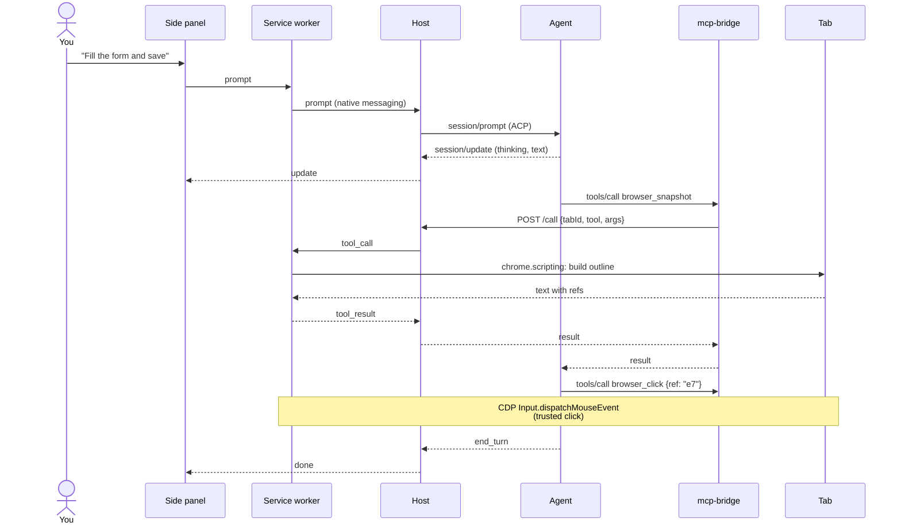
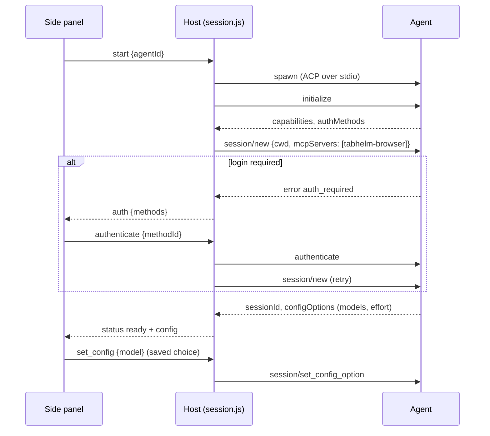
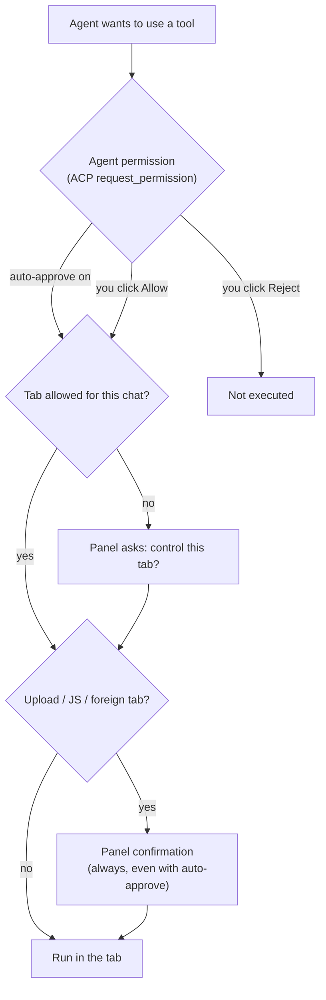

<p align="center"></p>

<h1 align="center">TabHelm</h1>

<p align="center">
  A Chrome side panel that lets terminal coding agents drive the tab you are looking at.<br>
  <b>English</b> · <a href="README.uk.md">Українська</a> · <a href="https://ivlad003.github.io/tabhelm/">Website</a>
</p>

Pick **Claude Code, Codex, Cursor Agent CLI, Gemini CLI, Google Antigravity, OpenCode, Qoder CLI or Grok** in the side panel, choose a model, and describe a task. The agent runs on your machine with its own login and reads, clicks and types on the current tab of your normal, logged-in Chrome — no headless browser.

## Contents

- [Quick start](#quick-start)
- [User guide](#user-guide)
- [Supported agents](#supported-agents)
- [Browser tools](#browser-tools)
- [How it works](#how-it-works)
- [Code tour](#code-tour)
- [Development](#development)
- [Troubleshooting](#troubleshooting)
- [Known limitations](#known-limitations)

## Quick start

**1. Install** (Linux or macOS, Node.js 20+):

```bash
curl -fsSL https://ivlad003.github.io/tabhelm/install.sh | bash
```

The installer downloads the latest release into `~/.tabhelm/app`, installs the native host's dependencies and registers it with Chrome, Chromium, Brave and Edge.

**2. Load the extension.** Open `chrome://extensions`, turn on **Developer mode**, click **Load unpacked** and choose `~/.tabhelm/app/extension`. You can also download [`tabhelm-extension.zip`](https://github.com/Ivlad003/tabhelm/releases/latest/download/tabhelm-extension.zip) from the website and load the unpacked folder; the native host from step 1 is still required.

**3. Use it.** Click the TabHelm icon on any page → pick an agent → **Connect** → write a task, e.g. *"Find the cheapest flight on this page and open it"*.

To update, run the install command again.

## User guide

### The panel

| Area | What it does |
|---|---|
| Agent list + **Connect** | Starts the chosen agent for this tab. Agents that are not installed are shown disabled, with an install hint. |
| Model + effort | Appear after connecting. The list comes from the agent itself (ACP `configOptions`). Your choice is remembered per agent. |
| **Controls: …** | The tab the agent is working on. It changes if the agent opens or switches tabs. |
| Chat | Agent replies, collapsible *Thinking*, plans, and an action log (`↳ Click "Save"`, `↳ Type "…" into "Email"`). |
| **Auto-approve actions** | Lets the agent use tools without asking. Uploads, JavaScript and other tabs still ask (see below). |
| **Send / Stop** | Sends a message; while the agent works, the button cancels the turn. |

### Approvals

There are two layers of confirmation:

1. **Agent permissions** — the agent asks before using a tool (ACP `session/request_permission`). You answer with its own buttons (*Allow once*, *Always allow*, *Reject*). **Auto-approve** answers these for you.
2. **TabHelm confirmations** — always shown, even with auto-approve: uploading local files, running JavaScript in the page (`browser_evaluate`), and controlling a tab the agent did not open.

### Signing in

If an agent needs a login, the panel shows its sign-in options as buttons. Click one and finish in the window that opens. You can also log in once in a terminal (`claude`, `codex login`, `agent login`, …) — TabHelm reuses the agent's own credentials.

- **Google Antigravity** offers *Log in with Google*, Gemini Enterprise, a Gemini API key or Agent Platform right in the panel.
- **Qoder CLI** reuses an existing login: run `qodercli login` once (for an agent installed with `install-agent`: `~/.tabhelm/agents/qoder/node_modules/.bin/qodercli login`).

### Tabs

Each tab has its own panel and its own agent session. By default the agent only works on that tab. It can open new tabs in the background (`browser_tabs` → `new`); pop-ups opened by the page are added automatically. Switching to any other tab requires your approval.

## Supported agents

| Agent | Launched as | Install |
|---|---|---|
| Claude Code | `claude-agent-acp` (bundled adapter) | [claude.com/claude-code](https://claude.com/claude-code) |
| Codex | `codex-acp` (bundled adapter) | `npm i -g @openai/codex` |
| Cursor Agent CLI | `agent acp` (or `cursor-agent acp`) | `curl https://cursor.com/install -fsS \| bash` |
| Gemini CLI | `gemini --acp` | `npm i -g @google/gemini-cli` |
| Google Antigravity | Google's ACP server `agy_acp_server.par` | `npm run install-agent antigravity` (in `~/.tabhelm/app/host`) |
| OpenCode | `opencode acp` | `curl -fsSL https://opencode.ai/install \| bash` |
| Qoder CLI | `qodercli --acp` | `npm run install-agent qoder` or `curl -fsSL https://qoder.com/install \| bash` |
| Grok (experimental) | `grok agent stdio` | from x.ai |

`npm run install-agent -- --list` shows every agent in the official [ACP registry](https://agentclientprotocol.com). Agents are detected on `PATH`; the installer records your `PATH` because Chrome starts the host with a minimal environment — rerun the installer after installing a new CLI.

## Browser tools

The agent sees 24 MCP tools, all scoped to the chat's tab:

| Group | Tools |
|---|---|
| Read | `browser_snapshot`, `browser_find`, `browser_get_text`, `browser_screenshot` (viewport / full page / element) |
| Mouse | `browser_click` (left/right/middle, double, modifiers), `browser_click_xy`, `browser_hover`, `browser_drag` |
| Keyboard & forms | `browser_type`, `browser_select_option`, `browser_press_key` (`Enter`, `F5`, `Control+A`…), `browser_upload_file`, `browser_scroll` |
| Navigation & tabs | `browser_navigate`, `browser_go_back`, `browser_go_forward`, `browser_reload`, `browser_tabs` |
| Waiting & dialogs | `browser_wait`, `browser_handle_dialog` |
| Diagnostics | `browser_console`, `browser_network`, `browser_evaluate` |

A snapshot is a compact text outline where interactive elements carry refs: `[e12] button "Save"`, or `[f3:e5]` inside iframe `f3`. Clicks and typing are sent through the Chrome DevTools Protocol (`Input.*`), so pages receive trusted events — also inside cross-origin iframes.

## How it works

### Components



- The **extension** owns the browser: one side panel per tab, a service worker that talks to the host, and the tool implementations.
- The **host** is started by Chrome through Native Messaging. It speaks **ACP** to the agent and runs a loopback **tool server**.
- The host passes `mcp-bridge.js` to the agent as an MCP server in ACP `session/new`, so no agent needs manual MCP configuration. The bridge forwards each tool call to the tool server, which relays it to the extension.

### One request, end to end



### Agent start-up and sign-in



### Safety layers



The tool server listens on `127.0.0.1` only, rejects requests with an `Origin` header and requires a random per-run token, so web pages and other local processes cannot drive the browser through it. The agent's first message includes a reminder to treat page content as untrusted data and to ask before irreversible actions.

## Code tour

```
extension/                     Chrome extension (Manifest V3, no build step)
  manifest.json                permissions, fixed key → stable extension ID
  background.js                service worker: side panel per tab, native port, confirmations
  browser-tools.js             tool dispatcher: refs, mouse/keyboard, tabs, screenshots, uploads
  cdp.js                       chrome.debugger sessions; dialog/console/network/file-chooser buffers
  page-scripts.js              functions injected into frames: snapshot, find, element geometry
  sidepanel.html|css|js        chat UI, model picker, approvals, action log
host/                          native host (Node 20+)
  src/native-host.js           entry point launched by Chrome; routes messages
  src/native-messaging.js      4-byte length-prefixed framing, 1 MB guard
  src/session.js               one ACP session per tab: start, auth, prompt, permissions, config
  src/agents.js                agent registry, PATH detection, install hints
  src/tool-server.js           loopback HTTP endpoint with token
  src/mcp-bridge.js            stdio MCP server spawned by agents (24 tool definitions)
  scripts/install.js           registers the native host (Chrome, Chromium, Brave, Edge)
  scripts/install-agent.js     installs agents from the ACP registry
  scripts/smoke.js | e2e.js | tools-test.js | icons.js
scripts/build.js               release build → dist/
site/                          GitHub Pages: landing page, install.sh, logo
.github/workflows/             release on tag, Pages deploy
docs/research.md               research notes (Ukrainian)
```

## Development

```bash
git clone https://github.com/Ivlad003/tabhelm && cd tabhelm/host
npm install
npm run install-host           # register the host for this checkout
```

Load `extension/` unpacked in Chrome. After editing extension files press ↻ on `chrome://extensions`; host changes apply the next time you press Connect.

| Command (in `host/`) | What it checks |
|---|---|
| `npm run smoke -- claude` | host + agent without Chrome (fake page); any agent id |
| `npm run test:tools` | every browser tool against a fixture page in headless Chrome (46 checks) |
| `npm run e2e -- claude` | panel → agent → fills a real form in headless Chrome |
| `E2E_MODEL=haiku npm run e2e -- claude` | same, plus model switching and restore |
| `TABHELM_RELEASE=../dist/tabhelm-x.y.z npm run e2e -- claude` | the built release |

**Build:** `npm run build` (repo root) writes `dist/`: the unpacked release, `tabhelm-extension[-x.y.z].zip` and `tabhelm[-x.y.z].tar.gz` (without `node_modules`; the Claude/Codex adapters bundle agent binaries, ~750 MB installed).

**Release:** bump `version` in `extension/manifest.json`, `host/package.json` and `package.json`, then push a tag `vX.Y.Z`. The *Release* workflow builds and publishes the assets; the *Pages* workflow publishes `site/` on pushes to `main`.

Logs: `~/.tabhelm/host.log`. Agents run in `~/.tabhelm/workspace`.

## Troubleshooting

| Symptom | Fix |
|---|---|
| "Host offline" in the panel | Run the installer (or `npm run install-host`) again, then reopen the panel. Check `~/.tabhelm/host.log`. |
| An installed agent is shown as "not installed" | Chrome started the host with an old `PATH`. Rerun the installer. |
| "Another debugger is attached" | Close DevTools on that tab. |
| "Chrome does not allow extensions to control …" | `chrome://` pages and the Chrome Web Store cannot be automated. |
| Agent answers "Upgrade your plan" | The selected model is not in your plan; pick another one. |

## Known limitations

- While the agent works, Chrome shows a "TabHelm started debugging this browser" bar. Only the `--silent-debugger-extension-api` flag hides it.
- Choosing a model in the panel goes through the agent, and some agents (e.g. Cursor) save it as their global default.
- Background tabs may not render, so screenshots there can fail.
- Cross-origin iframes are positioned by URL; if a frame navigated elsewhere, clicks fall back to DOM clicks and hover/drag are unavailable. File inputs inside iframes are not supported.
- Console and network capture starts when the agent first touches a tab.
- Closing the panel stops the agent; chat history is not kept.
- The installer supports Linux and macOS. The Chrome Web Store version is not published yet (the manifest's `key` field must be removed for the store).

TabHelm is an independent project and is not affiliated with Google, Anthropic, OpenAI, Cursor, Qoder or xAI.
