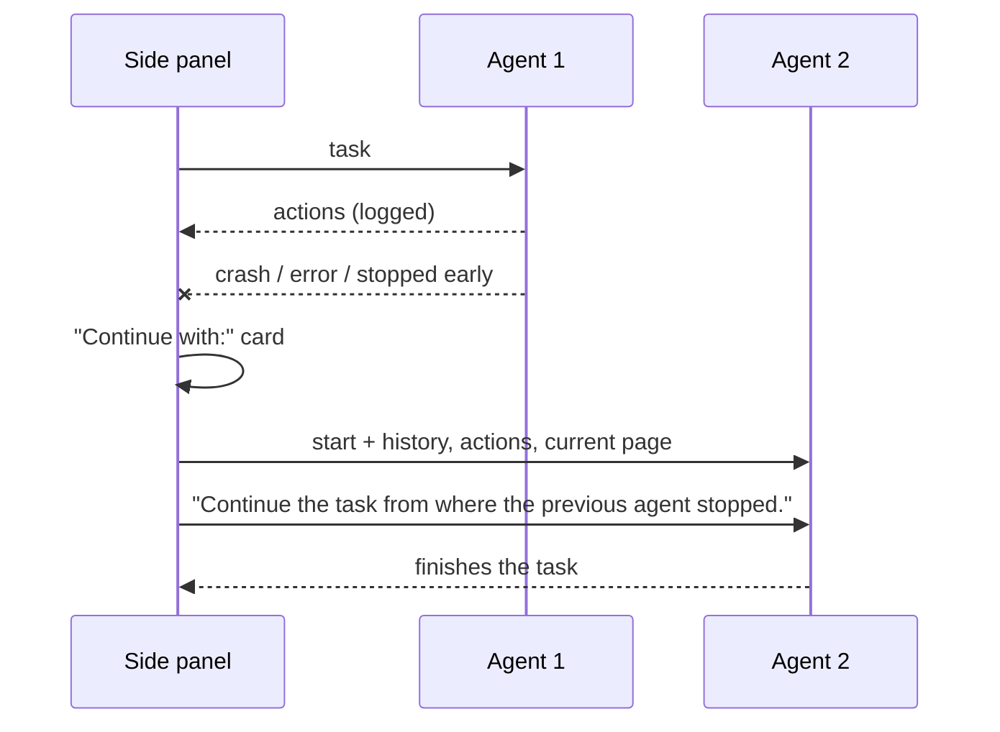
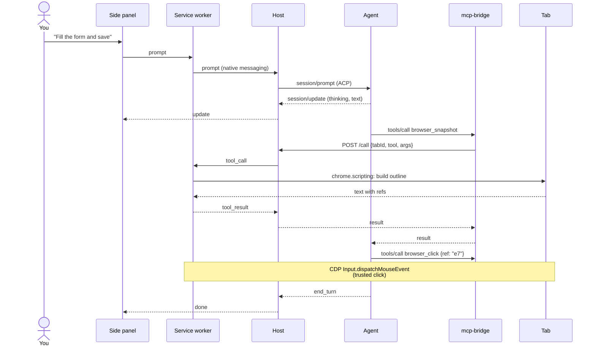
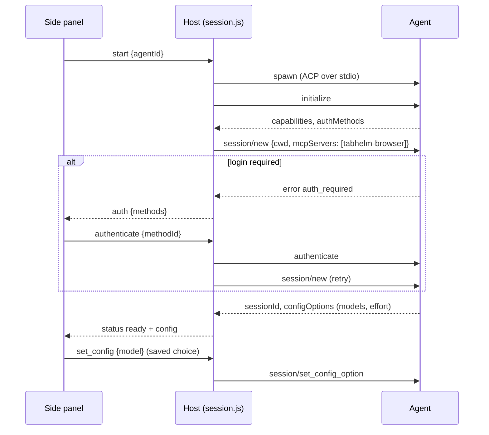
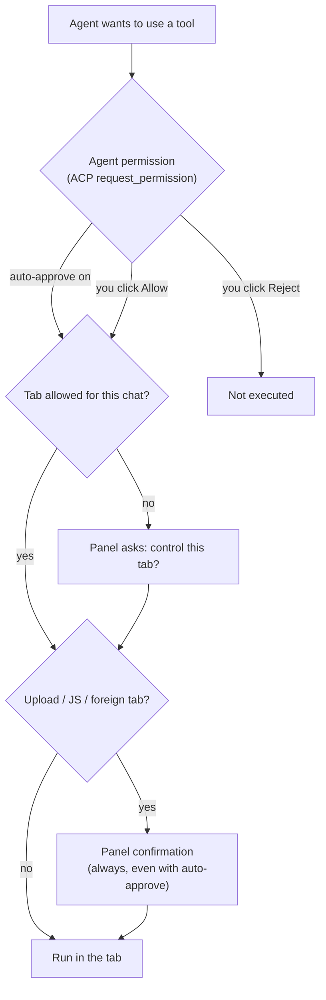

<p align="center"></p>

<h1 align="center">TabHelm</h1>

<p align="center">
  A Chrome side panel that lets terminal coding agents drive the tab you are looking at.<br>
  <b>English</b> · <a href="README.uk.md">Українська</a> · <a href="https://ivlad003.github.io/tabhelm/">Website</a> · <a href="CHANGELOG.md">Changelog</a>
</p>
<p align="center">
  <a href="https://github.com/Ivlad003/tabhelm/releases/latest"></a>
  <a href="CHANGELOG.md"></a>
  <a href="https://ivlad003.github.io/tabhelm/"></a>
</p>

Pick **Claude Code, Codex, Cursor Agent CLI, Google Antigravity, OpenCode, Qoder CLI or Grok** in the side panel, choose a model, and describe a task. The agent runs on your machine with its own login and reads, clicks and types on the current tab of your normal, logged-in Chrome — no headless browser.

## Contents

- [Quick start](#quick-start)
- [User guide](#user-guide)
- [Supported agents](#supported-agents)
- [Browser tools](#browser-tools)
- [How it works](#how-it-works)
- [Code tour](#code-tour)
- [Development](#development)
- [Troubleshooting](#troubleshooting)
- [Known limitations](#known-limitations)

## Quick start

**1. Install** (Node.js 20+). Linux / macOS:

```bash
curl -fsSL https://ivlad003.github.io/tabhelm/install.sh | bash
```

Windows (PowerShell):

```powershell
irm https://ivlad003.github.io/tabhelm/install.ps1 | iex
```

Windows (Command Prompt / cmd):

```bat
powershell -NoProfile -ExecutionPolicy Bypass -Command "irm https://ivlad003.github.io/tabhelm/install.ps1 | iex"
```

The installer downloads the latest release into `~/.tabhelm/app` (`%USERPROFILE%\.tabhelm\app` on Windows), installs the native host's dependencies and registers it with Chrome, Chromium, Brave and Edge (on Windows through the registry, HKCU).

**2. Load the extension.** Open `chrome://extensions`, turn on **Developer mode**, click **Load unpacked** and choose `~/.tabhelm/app/extension`. You can also download [`tabhelm-extension.zip`](https://github.com/Ivlad003/tabhelm/releases/latest/download/tabhelm-extension.zip) from the website and load the unpacked folder; the native host from step 1 is still required.

**3. Use it.** Click the TabHelm icon on any page → pick an agent → write a task, e.g. *"Find the cheapest flight on this page and open it"* → **Send**. The agent starts with your first message.

To update, run the install command again.

## User guide

### The panel

| Area | What it does |
|---|---|
| Agent list | The agent for this chat; it starts when you send the first message. Agents that are not installed are shown disabled, with an install hint. Changing the agent mid-chat hands the conversation over. |
| Model | Next to the agent. Before the agent is connected it shows your last choice; clicking it connects the agent and loads its full model list. The same list plus effort and other options are in **Settings → Model options**. Your choice is remembered per agent. |
| Chips | Shown only when needed: 🗂 the tab the agent is on when it is not this one / how many tabs are shared; 📁 the working folder. |
| Chat | Agent replies, collapsible *Thinking*, plans, and the agent's steps (`↳ Click "Save"`, tool search, …) grouped into one scrollable **Steps** block per run. |
| **＋ menu** | Everything optional in one place: attach files (or drop / paste them), add the page selection, voice message and tab audio (Voice feature), record video, share tabs (tab group), choose / change / remove the working folder. |
| **Auto-approve** | Lets the agent use tools without asking. Uploads, JavaScript, other tabs and the experimental gates still ask. |
| **Send / Stop** | Sends a message (and starts the agent if needed); while the agent works, the button cancels the turn. |
| **History** | Saved chats — open one to continue it (its page opens too) or export it (⬇ Markdown, `{ }` JSON). |
| **Settings** | Skills (links and, with the flag, skills written here), model options, experimental features, version and updates. |
| **New chat** | Clears the chat and starts a fresh session with the same agent and model. |

### Approvals

There are two layers of confirmation:

1. **Agent permissions** — the agent asks before using a tool (ACP `session/request_permission`). You answer with its own buttons (*Allow once*, *Always allow*, *Reject*). **Auto-approve** answers these for you.
2. **TabHelm confirmations** — always shown, even with auto-approve: uploading local files, running JavaScript in the page (`browser_evaluate`), and controlling a tab the agent did not open.

### Switching agents and continuing after a failure

Pick another agent in the list at any time between messages. TabHelm starts a fresh session for it and hands over the conversation together with your next message: your messages, each agent's answers, **every browser action they took** (including failed ones), work that was left unfinished, and the current page. The new agent can pick up exactly where the previous one stopped. The tab, approvals and the action log stay as they are; **New chat** drops this context. Reconnecting after a disconnect also hands the history over.

If an agent crashes, errors out or stops early in the middle of a task, the chat shows **"… did not finish. Continue with:"** and a button for every other installed agent. One click starts that agent and it continues the task automatically.



### Exporting a chat

In **History**, ⬇ downloads a chat as Markdown: your messages, each agent's answers (with thinking collapsed), every action with its time and result, approvals, model and agent switches, failures and saved recordings. `{ }` downloads the same events as JSON. The current chat is highlighted.

### Recording videos

Turn on **Record video** and every message you send is recorded until the agent finishes: the tab's frames (CDP screencast) are encoded in the panel with MediaRecorder (MP4/H.264, WebM fallback). An *agent cursor* with a click ripple is drawn on the page so the video shows where the agent pointed and clicked. Each video appears in the chat with a player, **Download** and **Delete** (click twice; removes it from the chat and from disk) and is saved automatically to `~/Videos/TabHelm/` (or `~/.tabhelm/recordings/` if there is no `~/Videos`). Only the visible tab renders frames, so tabs the agent opens in the background are not captured.

### History

Every chat is saved on your computer (messages, steps, stats, the page, agent and folder). **History** lists them with search. Opening a chat:

- if its tab is still open, TabHelm switches to that tab and opens the chat in its panel;
- otherwise the current tab goes back to the chat's page and the chat is shown here.

To continue, connect any agent — it gets the whole conversation with your next message. Closing and reopening the panel on a tab restores that tab's chat. Delete chats with ×; up to 200 are kept.

### Working folder (project)

By default agents run in an empty `~/.tabhelm/workspace`. **Folder…** opens a menu: choose a folder with the system dialog, pick a recent one, or type a path. This binds the chat to a project folder:

- agents start in that folder, so they pick up the project's own **AGENTS.md / CLAUDE.md / rules** and can **create and edit files, write code and run scripts** there when you ask — for example with documentation open in the tab and your code in the folder;
- the project's skills (`.claude/skills`, `.agents/skills`, `.opencode/skills`, `.cursor/skills`, `skills/` — each `*/SKILL.md`) are added for every agent and read with `skill_read`;
- the built-in agent (OpenRouter/Ollama) gets the AGENTS.md text in its first message; it has browser tools only, no file tools;
- changing the folder restarts the agent there and hands the conversation over; the folder is remembered while the browser runs, and recent folders are suggested.

With **Auto-approve** on, the agent edits files and runs commands in the folder without asking — the panel shows a warning. Agents' own permission prompts apply otherwise.

### Task stats

Under every answer the panel shows the time the task took and, when the agent reports them, tokens, cost and context use — e.g. `⏱ 11.9 s · 117k tokens · $0.17 · context 39k / 1.0M` (hover for input/output/cached tokens). Claude Code, OpenCode, Kilo and the built-in OpenRouter agent report tokens and cost; Codex reports tokens; Cursor and Grok only get the time. Totals are in the Markdown export.

### Attachments

Attach up to 10 files per message with **Attach**, by dropping them on the panel, or by pasting an image into the message box. Images are downscaled to 1600 px; text files can be up to 300 KB. Each agent gets them in the form it supports: images and embedded files over ACP where possible; otherwise TabHelm saves the image into the agent's workspace (`~/.tabhelm/workspace/attachments`) and tells the agent the path, and puts text files inline in the message. The built-in agent passes images to models marked *vision*. Checked with Claude Code, Codex, OpenCode, Cursor, Grok and the built-in agent.

### Page selection and images

Select text on the page and right-click → **Add selection to TabHelm chat** (or press **Alt+Shift+T**, or use **＋ → Add page selection**); right-click an image → **Add image to TabHelm chat**. The panel opens if needed and a chip appears in the message box: ❝ for a quote, a thumbnail for an image. Write your question and send — the quote goes to the agent with the page's address, the image as an attachment. Send with an empty box to just discuss the selection.

### Skills

Skills are `SKILL.md` files — a name, a description and instructions that make an agent better at a kind of task (for example [Anthropic's skills](https://github.com/anthropics/skills)). In **Settings → Skills** paste a link to a `SKILL.md` file or a skill folder on GitHub (also raw links and gists) and press **Add**. Nothing is installed: TabHelm loads the skill from the link (cached for an hour, the cached copy is used offline), and every agent — CLIs and the built-in one — gets the list of enabled skills with its first message. When a task matches, the agent reads the skill with `skill_read` (and other files of the skill with `skill_read_file`) and follows it. Toggle or remove skills at any time; the running agent is told from its next message.

Only add skills you trust: their text becomes instructions for the agent.

### Experimental features (all off by default)

**Settings → Experimental** lists features that are switched off until you enable them. Each shows its own settings once on.

| Feature | What it does | Needs |
|---|---|---|
| **Action critic** | A second model checks every page-changing action against your task and the recent steps: *allow*, *ask you* (a card with its reason) or *block*. Unreachable critic → asks you. | the built-in agent's provider: OpenRouter key or local Ollama |
| **Site rules** | Categories (banking, government, health, adult, piracy) set to allow / ask / block, plus your own deny and allow lists. Checked for the page and for navigation targets. | — |
| **Sensitive actions** | Clicks, Enter and navigations whose target contains a keyword (pay, buy, send, delete, sign in, submit…) always ask first, even with auto-approve. Keywords are editable. | — |
| **Plan preview** | The agent first replies with a short plan and stops; **Start** sends it off, or tell it what to change. | — |
| **Take over** | **Pause — I take over** holds the agent's next action until you press **Resume**; the agent can call `browser_request_human` to ask for a 2FA code, a captcha or a choice and waits for your **Done**. | — |
| **Scheduled tasks** | Name, page, task, agent, interval. Runs in a background tab with Chrome open, auto-approves if you say so, saves the result to History and notifies you. Runs cannot ask you anything. | — |
| **Developer tools** | `browser_fill_form` (many fields at once), `browser_network_body` (request/response bodies), `browser_storage` (cookies, localStorage, sessionStorage; writes ask first), `browser_emulate` (viewport, mobile, user agent, color scheme, geolocation, timezone, locale), `browser_highlight` (outline elements for you). | — |
| **Secrets** | Named values the agent uses as `{{SECRET:name}}`; substituted on the page only. The model, the action log, history and exports see the placeholder. | — |
| **Memory** | Notes that persist across chats in `~/.tabhelm/memory.json`: global or per site. Matching notes go to the agent with its first message; it can add notes with `memory_save` and look them up with `memory_search`. Manage them in Settings. | — |
| **Skill authoring & slash commands** | Write skills (name, description, instructions) in the panel; they work like skills from links. Type `/` in the message box for a menu: `/name task` runs that skill; `/new`, `/export`, `/pause` are built in. | — |
| **Password manager hand-off** | For sign-in forms the agent calls `browser_request_login`; you pick **Fill with 1Password** (host runs `op`, the extension types the values, the model never sees them) or **Chrome's passwords — I'll sign in** (you use Chrome's saved login, then press Done). | 1Password CLI (`op signin`) for the first path |
| **Action database** | Steps keep timestamps; a recording lists its steps and clicking one jumps to that moment in the video; History search also searches steps. | — |
| **Notifications** | Badge on the chat's tab (✓ done, ! stopped, ? needs you) and a system notification; clicking it opens the tab. | — |
| **Voice** | **🎤 Voice → Microphone** records a voice message; **Tab audio** captures what the tab is playing (a video, a call) — the tab keeps playing for you. Text appears live and, on **Stop**, the whole transcript becomes one message in the box to edit and send. Microphone uses Chrome's own recognition (no setup) or the host; tab audio always uses the host: `whisper-cli` + `ffmpeg` + a ggml model, or an OpenAI-compatible transcription API via `TABHELM_TRANSCRIBE_BASE_URL` / `_API_KEY` / `_MODEL` in `~/.tabhelm/env` (e.g. Groq's Whisper). First microphone use opens a page to grant Chrome access. | whisper.cpp or an API for the host engine |

Security notes: the critic, site rules and the sensitive gate run in the extension before a tool executes, so they also cover agents that auto-approve their own tools. Secrets live in this browser profile's extension storage. Scheduled runs are unattended by design — give them narrow tasks.

### Updates and news

The panel checks `https://ivlad003.github.io/tabhelm/news.json` (at most once an hour; **Settings → Check for updates** checks right away). When a newer release exists it shows **"TabHelm X is available"** with an **Update** button (the install command to copy, then ↻ on `chrome://extensions`) and a link to the release notes. Project news appears as a separate banner. Dismissed banners do not come back; the panel works normally when offline.

The update banner appears only when the release is **newer than the extension Chrome has loaded**. If you run TabHelm from a git checkout (`Load unpacked` on the repository's `extension/` folder), you already have the newest code — pull, then press ↻ for TabHelm on `chrome://extensions`. **Settings** shows the extension and host versions and warns when they differ.

### Signing in

If an agent needs a login, the panel shows its sign-in options as buttons. Click one and finish in the window that opens. You can also log in once in a terminal (`claude`, `codex login`, `agent login`, …) — TabHelm reuses the agent's own credentials.

- **Google Antigravity** offers *Log in with Google*, Gemini Enterprise, a Gemini API key or Agent Platform right in the panel.
- **Qoder CLI** reuses an existing login: run `qodercli login` once (for an agent installed with `install-agent`: `~/.tabhelm/agents/qoder/node_modules/.bin/qodercli login`).

### Several tabs

Each tab has its own panel and its own agent session, and by default the agent works on that tab only. To let it work across tabs — move data from one page to another, compare pages, search several pages at once:

- press **Group tabs**: the chat's tab goes into a green Chrome tab group named *TabHelm*. **Drag any tab into that group** and the agent can use it without asking; drag it out to stop sharing. The button shows how many tabs are in the group, and the TabHelm icon on a grouped tab opens the chat.
- the agent can also open tabs itself (`browser_tabs` → `new`, added to the group); pop-ups opened while it acts are added automatically; any other tab still needs your approval.
- every page tool takes a `tabId`, so the agent reads one tab and types into another without switching; `browser_search_tabs` finds text in all the tabs it can use.

Example: with a contact card in one tab and a form in the chat's tab, "copy the email from the other tab into this form" works in a few steps.

## Supported agents

| Agent | Launched as | Install |
|---|---|---|
| Claude Code | `claude-agent-acp` (bundled adapter) | [claude.com/claude-code](https://claude.com/claude-code) |
| Codex | `codex-acp` (bundled adapter) | `npm i -g @openai/codex` |
| Cursor Agent CLI | `agent acp` (or `cursor-agent acp`) | `curl https://cursor.com/install -fsS \| bash` |
| Google Antigravity | Google's ACP server `agy_acp_server.par` | `npm run install-agent -- antigravity` |
| OpenCode | `opencode acp` | `curl -fsSL https://opencode.ai/install \| bash` |
| Qoder CLI | `qodercli --acp` | `npm run install-agent -- qoder` or `curl -fsSL https://qoder.com/install \| bash` |
| Kilo Code | `kilo acp` | `npm run install-agent -- kilo` |
| Cline | `cline --acp` | `npm run install-agent -- cline` |
| CodeBuddy Code | `codebuddy --acp` | `npm run install-agent -- codebuddy` |
| Grok (experimental) | `grok agent stdio` | from x.ai |
| **OpenRouter (built-in)** | TabHelm's own agent → OpenRouter API | `npm run set-key -- openrouter` |
| **Ollama (built-in, local)** | TabHelm's own agent → local Ollama | [ollama.com](https://ollama.com), then `ollama pull <model>` |
| **OpenAI-compatible (built-in)** | TabHelm's own agent → any `/v1/chat/completions` API | `TABHELM_OPENAI_BASE_URL` (+ `TABHELM_OPENAI_API_KEY`, `TABHELM_OPENAI_MODEL`) in `~/.tabhelm/env` |

`npm run install-agent -- <name>` (in `~/.tabhelm/app/host`) installs **any** agent from the official [ACP registry](https://agentclientprotocol.com) into `~/.tabhelm/agents/<name>` — TabHelm lists it automatically, no code changes. `npm run install-agent -- --list` shows all of them (40+). Agents are detected on `PATH`; the installer records your `PATH` because Chrome starts the host with a minimal environment — rerun the installer after installing a new CLI.

### Free options

Checked in October 2026 — free offers change often, so check the vendor's pricing page before relying on one.

| Agent | What is free | Sign-in |
|---|---|---|
| **Kilo Code** | `kilo-auto/free` (TabHelm's default for Kilo) routes to free models; may hit rate limits. Worked without signing in in our test | Kilo account for more |
| **Cline** | Rotating free models in the Cline provider | Cline account |
| **CodeBuddy Code** | 100 credits a month + 250 sign-up bonus (14 days) | codebuddy.ai (Google/GitHub) |
| **Qoder CLI** | 100 free credits a day, each batch valid 30 days | Qoder account |
| **OpenRouter (built-in)** | `:free` models, 50 requests/day (1000/day after a one-time $10 top-up) | API key |
| **Google Antigravity** | Personal Google account | Google |
| **Ollama (built-in)** | Local models, no limits | — |
| GitHub Copilot CLI (`install-agent -- copilot`) | Copilot Free includes the CLI; small, unpublished allowance | GitHub |
| Mistral Vibe (`install-agent -- vibe`) | Free plan: limited coding sessions | Mistral account |
| goose (`install-agent -- goose`) | $10 one-off credit via Tetrate on first sign-in | Tetrate |
| Poolside (`install-agent -- poolside`) | Free platform login; limits not documented | Poolside account |

Not free for CLI use: Codex on a free ChatGPT account (no CLI access), Factory Droid, Auggie (card-gated trial), GLM Agent, MiniMax Code, Kimi CLI, Amp (bring your own key; free credits paused), Qwen Code (free tier closed in April 2026).

### Built-in agent: OpenRouter, Ollama and free models

Besides the CLIs, TabHelm ships its own small agent (`host/src/builtin-agent.js`) that talks to any OpenAI-compatible API directly — no extra CLI needed. It runs the same loop as the others (model → browser tool → result), streams answers and reasoning, asks before actions that change the page (read-only tools run without asking), retries rate limits, and shortens old page snapshots to save tokens.

- **OpenRouter** — the model list shows tool-calling models only, **free (`:free`) ones first**. Free models are limited to 20 requests/minute and 50/day (1000/day after a one-time $10 top-up); a browser task takes roughly 10–20 requests. Add the key once:
  ```bash
  cd ~/.tabhelm/app/host && npm run set-key -- openrouter
  ```
  The key is stored in `~/.tabhelm/env` (mode 600). If it is missing, the panel shows what to do.
- **Ollama** — local and free; lists the models you have pulled. Small models (7–9B) struggle with multi-step browser tasks; 27–32B or 30B MoE models on a 24 GB GPU work much better (see `docs/research.md`).
- **OpenAI-compatible** — any other provider (Groq, Google AI Studio, LM Studio, vLLM…) via `TABHELM_OPENAI_BASE_URL`.

`~/.tabhelm/env` is loaded by the host for every agent, so it is also the place for keys that CLIs read from the environment (e.g. a Codex profile that uses OpenRouter).

## Browser tools

The agent sees 25 MCP tools, scoped to the chat's tab and the tabs shared with it (every page tool also accepts `tabId`):

| Group | Tools |
|---|---|
| Read | `browser_snapshot`, `browser_find`, `browser_get_text`, `browser_screenshot` (viewport / full page / element) |
| Mouse | `browser_click` (left/right/middle, double, modifiers), `browser_click_xy`, `browser_hover`, `browser_drag` |
| Keyboard & forms | `browser_type`, `browser_select_option`, `browser_press_key` (`Enter`, `F5`, `Control+A`…), `browser_upload_file`, `browser_scroll` |
| Navigation & tabs | `browser_navigate`, `browser_go_back`, `browser_go_forward`, `browser_reload`, `browser_tabs`, `browser_search_tabs` |
| Waiting & dialogs | `browser_wait`, `browser_handle_dialog` |
| Diagnostics | `browser_console`, `browser_network`, `browser_evaluate` |

A snapshot is a compact text outline where interactive elements carry refs: `[e12] button "Save"`, or `[f3:e5]` inside iframe `f3`. Clicks and typing are sent through the Chrome DevTools Protocol (`Input.*`), so pages receive trusted events — also inside cross-origin iframes.

## How it works

### Components


- The **extension** owns the browser: one side panel per tab, a service worker that talks to the host, and the tool implementations.
- The **host** is started by Chrome through Native Messaging. It speaks **ACP** to the agent and runs a loopback **tool server**.
- The host passes `mcp-bridge.js` to the agent as an MCP server in ACP `session/new`, so no agent needs manual MCP configuration. The bridge forwards each tool call to the tool server, which relays it to the extension.

### One request, end to end



### Agent start-up and sign-in



### Safety layers



The tool server listens on `127.0.0.1` only, rejects requests with an `Origin` header and requires a random per-run token, so web pages and other local processes cannot drive the browser through it. The agent's first message includes a reminder to treat page content as untrusted data and to ask before irreversible actions.

## Code tour

```
extension/                     Chrome extension (Manifest V3, no build step)
  manifest.json                permissions, fixed key → stable extension ID
  background.js                service worker: side panel per tab, native port, confirmations
  browser-tools.js             tool dispatcher: refs, mouse/keyboard, tabs, screenshots, uploads
  cdp.js                       chrome.debugger sessions; dialog/console/network/file-chooser buffers
  page-scripts.js              functions injected into frames: snapshot, find, element geometry
  sidepanel.html|css|js        chat UI, model picker, approvals, action log, new chat, agent hand-over, video recorder
  news.js                      update / news banner from the site's news.json
  settings.js                  Settings view: skills from links, versions, update check
  experimental.js              Settings → Experimental: feature flags and their settings
  features.js                  feature flags and settings storage (all off by default)
  policy.js                    action policy: site rules, sensitive gate, critic bridge, secrets, pause
  scheduler.js                 scheduled tasks (chrome.alarms, background runs)
  voice.js                     voice messages / tab audio with live transcription · permissions.html  microphone grant
  attachments.js               image / text attachments: picking, drop, paste, downscaling
  folder.js                    working folder: picker, typed path, recent folders, auto-approve warning
  history.js                   saved chats: storage, list, search, opening in the chat's tab
  tokens.css                   copy of design/tokens.css
host/                          native host (Node 20+)
  src/native-host.js           entry point launched by Chrome; routes messages, saves recordings
  src/native-messaging.js      4-byte length-prefixed framing, 1 MB guard
  src/session.js               one ACP session per tab: start, auth, prompt, permissions, config
  src/agents.js                agent registry, PATH detection, install hints
  src/builtin-agent.js         TabHelm's own ACP agent for OpenRouter / Ollama / OpenAI-compatible APIs
  src/env.js                   ~/.tabhelm/env (API keys) loading and saving
  src/skills.js                skills from links: URL resolution, SKILL.md parsing, cache, skill_* tools
  src/folders.js               working folder: native picker, AGENTS.md / project skills discovery
  src/critic.js                action critic (second model) · src/llm.js  OpenAI-compatible helper
  src/memory.js                memory notes across chats · src/passwords.js  1Password CLI hand-off
  src/transcribe.js            speech to text: transcription API or whisper.cpp + ffmpeg
  src/tool-server.js           loopback HTTP endpoint with token
  src/mcp-bridge.js            stdio MCP server spawned by agents (24 tool definitions)
  scripts/install.js           registers the native host (Chrome, Chromium, Brave, Edge)
  scripts/install-agent.js     installs any ACP-registry agent and records how to launch it
  scripts/set-key.js           stores an API key in ~/.tabhelm/env without echoing it
  scripts/smoke.js | e2e.js | tools-test.js | icons.js
design/                        design system: tokens.css (source of truth) and its guide
scripts/design.js              copies design tokens into the extension and the site
scripts/build.js               release build → dist/
scripts/news.js                builds news.json (site/news.json + latest release) for Pages
scripts/release-notes.js       release notes from CHANGELOG.md
site/                          GitHub Pages: landing page, install.sh, news.json source, logo
.github/workflows/             release on tag, Pages deploy
docs/research.md               research notes (Ukrainian)
```

## Development

```bash
git clone https://github.com/Ivlad003/tabhelm && cd tabhelm/host
npm install
npm run install-host           # register the host for this checkout
```

Load `extension/` unpacked in Chrome. After editing extension files press ↻ on `chrome://extensions`; host changes apply the next time an agent starts (New chat or a new message after a stop).

| Command (in `host/`) | What it checks |
|---|---|
| `npm run smoke -- claude` | host + agent without Chrome (fake page); any agent id |
| `npm run test:tools` | every browser tool against a fixture page in headless Chrome (46 checks) |
| `npm run e2e -- claude` | panel → agent → fills a real form in headless Chrome |
| `E2E_MODEL=haiku npm run e2e -- claude` | same, plus model switching and restore |
| `E2E_RECORD=1 E2E_SWITCH=opencode npm run e2e -- claude` | same, plus video recording, agent hand-over and New chat |
| `E2E_FAILOVER=opencode npm run e2e -- claude` | kills the agent mid-task, continues with OpenCode, checks the Markdown export |
| `E2E_NEWS=1 npm run e2e` | update and news banners against a local feed |
| `E2E_TABS=1 npm run e2e -- claude` | shares a second tab through the tab group and asks the agent to move data between tabs |
| `E2E_HISTORY=1 npm run e2e -- claude` | steps block, saved history, reopening a chat (tab goes back to its page), continuing it, restore after reopening the panel |
| `E2E_FOLDER=1 npm run e2e -- claude` | binds a project folder (AGENTS.md + skill) and checks the agent follows it and creates a file there |
| `E2E_ATTACH=1 npm run e2e -- claude` | attaches an image and a CSV and checks the agent reads both |
| `E2E_SKILLS=1 npm run e2e -- claude` | adds a skill in Settings and checks the agent reads and follows it |
| `npm run test:flags` | every experimental feature with the built-in agent against a scripted mock model and a fake microphone (20 checks) |
| `npm run test:builtin` | built-in agent against a mock OpenAI-compatible API (streaming, tool calls, 429 retry, missing key) |
| `TABHELM_RELEASE=../dist/tabhelm-x.y.z npm run e2e -- claude` | the built release |

**Build:** `npm run build` (repo root) writes `dist/`: the unpacked release, `tabhelm-extension[-x.y.z].zip` and `tabhelm[-x.y.z].tar.gz` (without `node_modules`; the Claude/Codex adapters bundle agent binaries, ~750 MB installed).

**Design:** colours, radii and fonts come from [`design/tokens.css`](design/README.md) (soft emerald, light and dark). After editing it run `npm run design`.

**Release:** add a section to `CHANGELOG.md`, bump `version` in `extension/manifest.json`, `host/package.json` and `package.json`, then push a tag `vX.Y.Z`. The release notes are taken from the changelog. The *Release* workflow builds and publishes the assets and re-runs *Pages*, so the update banner appears in everyone's panel. *Pages* also publishes `site/` on pushes to `main`.

**News:** add an item to `site/news.json` (`id`, `title`/`text` with `en` and `uk`, optional `url`, `minVersion`, `maxVersion`) and push to `main`. The Pages workflow merges it with the latest release (`scripts/news.js`) into the published `news.json`. To test a feed locally, set `newsUrl` in the extension's `chrome.storage.local` (see `E2E_NEWS=1 npm run e2e`).

Logs: `~/.tabhelm/host.log`. Agents run in `~/.tabhelm/workspace`.

## Troubleshooting

| Symptom | Fix |
|---|---|
| "Host offline" in the panel | Run the installer (or `npm run install-host`) again, then reopen the panel. Check `~/.tabhelm/host.log`. |
| An installed agent is shown as "not installed" | Chrome started the host with an old `PATH`. Rerun the installer. |
| "Another debugger is attached" | Close DevTools on that tab. |
| "Chrome does not allow extensions to control …" | `chrome://` pages and the Chrome Web Store cannot be automated. |
| Agent answers "Upgrade your plan" | The selected model is not in your plan; pick another one. |

## Known limitations

- While the agent works, Chrome shows a "TabHelm started debugging this browser" bar. Only the `--silent-debugger-extension-api` flag hides it.
- Choosing a model in the panel goes through the agent, and some agents (e.g. Cursor) save it as their global default.
- Background tabs may not render, so screenshots there can fail.
- Cross-origin iframes are positioned by URL; if a frame navigated elsewhere, clicks fall back to DOM clicks and hover/drag are unavailable. File inputs inside iframes are not supported.
- Console and network capture starts when the agent first touches a tab.
- Closing the panel stops the agent; chat history is not kept.
- Recordings capture only the visible tab and contain no audio.
- Windows support is new and less tested than Linux/macOS; the folder picker uses a PowerShell dialog, 1Password needs `op.exe` on PATH, tab audio needs `ffmpeg`/`whisper-cli` or a transcription API. The Chrome Web Store version is not published yet (the manifest's `key` field must be removed for the store).

TabHelm is an independent project and is not affiliated with Google, Anthropic, OpenAI, Cursor, Qoder or xAI.
