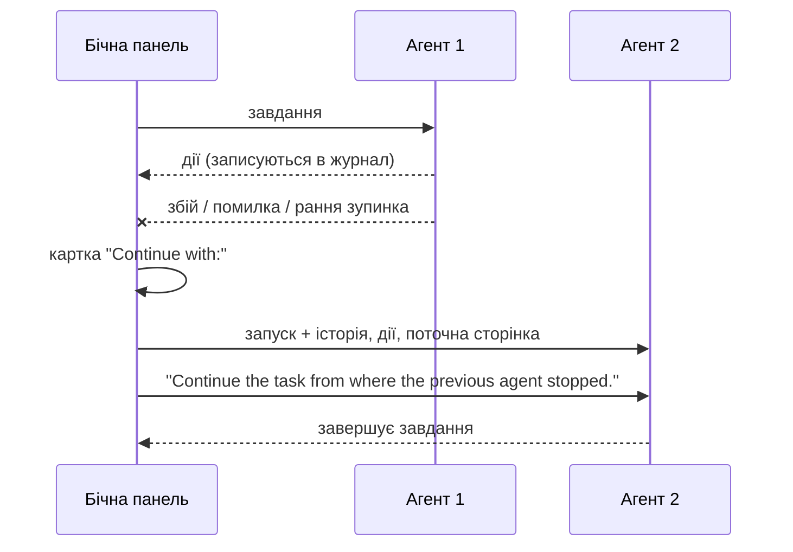
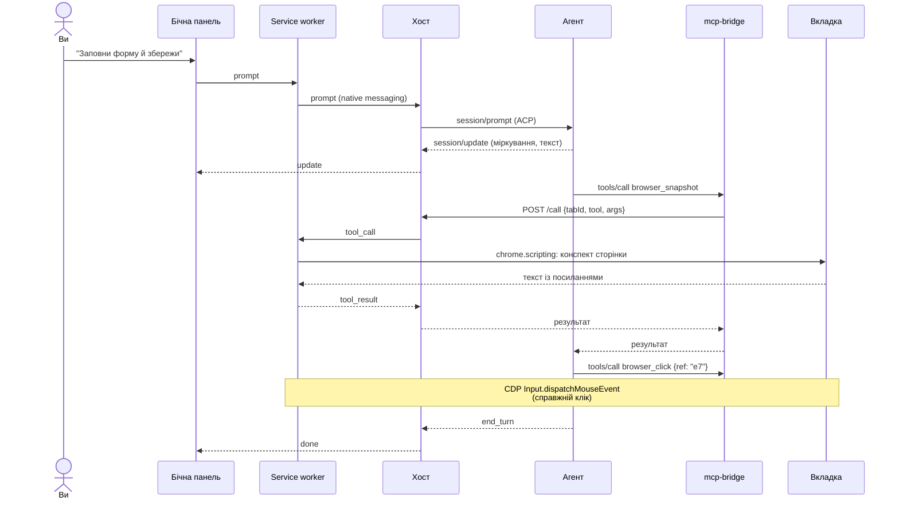
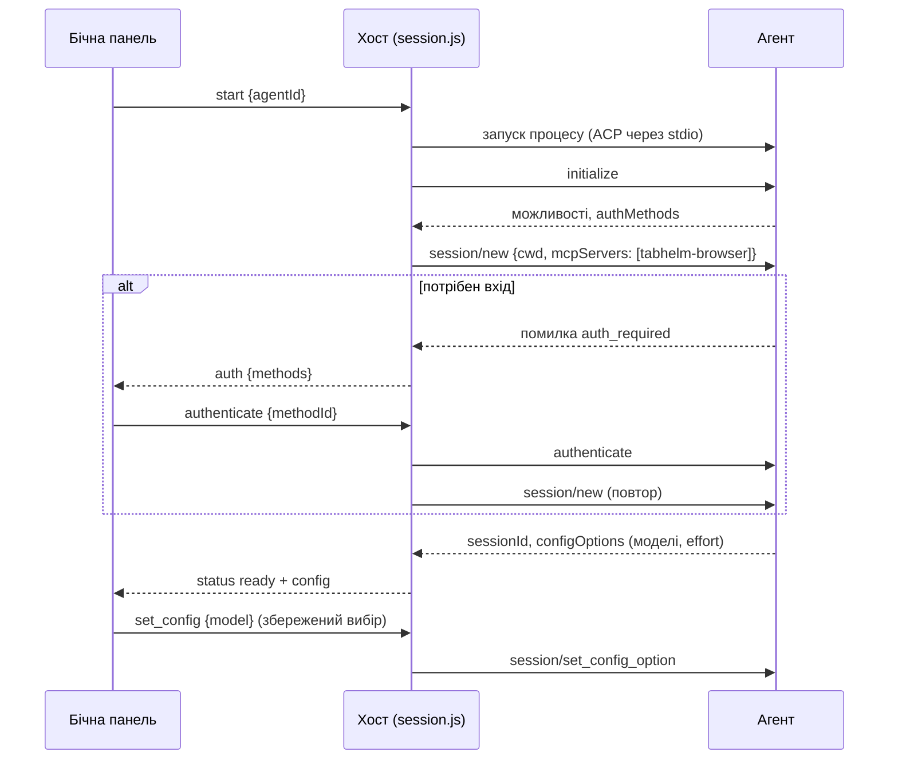
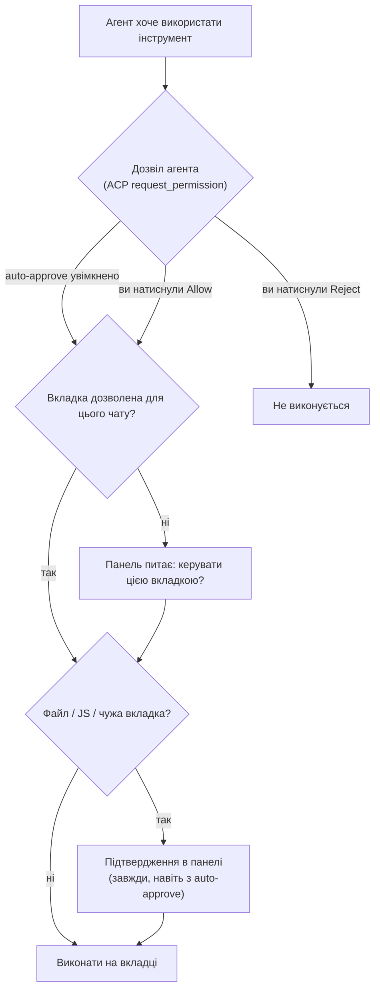

<p align="center"></p>

<h1 align="center">TabHelm</h1>

<p align="center">
  Бічна панель Chrome, через яку терміналні агенти керують вкладкою, що у вас перед очима.<br>
  <a href="README.md">English</a> · <b>Українська</b> · <a href="https://ivlad003.github.io/tabhelm/">Сайт</a> · <a href="CHANGELOG.md">Changelog</a>
</p>
<p align="center">
  <a href="https://github.com/Ivlad003/tabhelm/releases/latest"></a>
  <a href="CHANGELOG.md"></a>
  <a href="https://ivlad003.github.io/tabhelm/"></a>
</p>

Оберіть у бічній панелі **Claude Code, Codex, Cursor Agent CLI, Google Antigravity, OpenCode, Qoder CLI або Grok**, виберіть модель і опишіть завдання. Агент працює на вашому комп'ютері зі своїм логіном і читає, клікає та вводить текст на поточній вкладці вашого звичайного Chrome, де ви вже залогінені. Headless-браузер не потрібен.

## Зміст

- [Швидкий старт](#швидкий-старт)
- [Посібник користувача](#посібник-користувача)
- [Підтримувані агенти](#підтримувані-агенти)
- [Браузерні інструменти](#браузерні-інструменти)
- [Як це працює](#як-це-працює)
- [Огляд коду](#огляд-коду)
- [Розробка](#розробка)
- [Розв'язання проблем](#розвязання-проблем)
- [Відомі обмеження](#відомі-обмеження)

## Швидкий старт

**1. Встановлення** (Linux або macOS, Node.js 20+):

```bash
curl -fsSL https://ivlad003.github.io/tabhelm/install.sh | bash
```

Інсталятор завантажує останній реліз у `~/.tabhelm/app`, ставить залежності native host і реєструє його в Chrome, Chromium, Brave та Edge.

**2. Завантажте розширення.** Відкрийте `chrome://extensions`, увімкніть **Developer mode**, натисніть **Load unpacked** і виберіть `~/.tabhelm/app/extension`. Можна також завантажити [`tabhelm-extension.zip`](https://github.com/Ivlad003/tabhelm/releases/latest/download/tabhelm-extension.zip) із сайту й підключити розпаковану папку, але native host із кроку 1 потрібен однаково.

**3. Користуйтеся.** Натисніть іконку TabHelm на будь-якій сторінці → оберіть агента → **Connect** → напишіть завдання, наприклад *«Знайди найдешевший рейс на цій сторінці й відкрий його»*.

Щоб оновитися, запустіть команду встановлення ще раз.

## Посібник користувача

### Панель

| Елемент | Що робить |
|---|---|
| Список агентів + **Connect** | Запускає обраного агента для цієї вкладки. Невстановлені агенти показані неактивними, з підказкою, як їх встановити. |
| Модель + effort | З'являються після підключення. Список дає сам агент (ACP `configOptions`). Вибір запам'ятовується окремо для кожного агента. |
| **Controls: …** | Вкладка, з якою працює агент. Змінюється, якщо агент відкриває нову вкладку або перемикається. |
| Чат | Відповіді агента, згорнутий блок *Thinking*, план і журнал дій (`↳ Click "Save"`, `↳ Type "…" into "Email"`). |
| **Auto-approve actions** | Агент користується інструментами без запитів. Завантаження файлів, JavaScript та інші вкладки однаково потребують підтвердження (див. нижче). |
| **Send / Stop** | Надсилає повідомлення; поки агент працює, кнопка зупиняє його. |
| **Folder…** | Робоча папка (проєкт) для чату за бажанням — див. нижче. |
| **Attach** | Додає до повідомлення картинки й текстові файли (txt, md, csv, tsv, json, log). Файли можна також перетягнути на панель або вставити картинку з буфера. |
| **New chat** | Очищає чат і запускає нову сесію з тим самим агентом і моделлю. |
| **Export** | Завантажує чат із журналом дій агента в Markdown або повний журнал подій у JSON. |
| **Settings** | Скіли за посиланням, версії та **Check for updates**. |
| **Record video** | Записує вкладку, поки агент виконує кожне повідомлення (див. нижче). |

### Підтвердження

Є два рівні:

1. **Дозволи агента.** Агент питає перед використанням інструмента (ACP `session/request_permission`). Ви відповідаєте його кнопками (*Allow once*, *Always allow*, *Reject*). **Auto-approve** відповідає за вас.
2. **Підтвердження TabHelm.** Показуються завжди, навіть з auto-approve: завантаження локальних файлів на сайт, виконання JavaScript на сторінці (`browser_evaluate`) і керування вкладкою, яку агент не відкривав сам.

### Перемикання агента і продовження після збою

Між повідомленнями можна будь-коли вибрати іншого агента. TabHelm запускає для нього нову сесію й разом із наступним повідомленням передає: ваші повідомлення, відповіді кожного агента, **усі дії в браузері** (зокрема невдалі), незавершену роботу й поточну сторінку. Новий агент продовжує саме з того місця, де зупинився попередній. Вкладка, дозволи й журнал дій лишаються як були; **New chat** скидає цей контекст. Повторне підключення після розриву теж передає історію.

Якщо агент падає, видає помилку або зупиняється посеред завдання, у чаті з'являється **«… did not finish. Continue with:»** з кнопкою для кожного іншого встановленого агента. Один клік — і обраний агент автоматично продовжує завдання.



### Експорт чату

**Export → Chat + action log (.md)** завантажує читабельний запис: ваші повідомлення, відповіді агентів (міркування згорнуті), кожну дію з часом і результатом, підтвердження, зміни моделі й агента, збої та збережені відео. **Full log (.json)** містить ті самі події у структурованому вигляді.

### Запис відео

Увімкніть **Record video**, і кожне надіслане повідомлення записуватиметься, доки агент не закінчить. Кадри вкладки (CDP screencast) кодуються прямо в панелі через MediaRecorder (MP4/H.264, запасний варіант — WebM). На сторінці малюється *курсор агента* з анімацією кліку, тож на відео видно, куди агент наводив і клікав. Кожне відео з'являється в чаті з плеєром, кнопками **Download** і **Delete** (подвійний клік; видаляє з чату й з диска) та автоматично зберігається в `~/Videos/TabHelm/` (або `~/.tabhelm/recordings/`, якщо `~/Videos` немає). Кадри рендерить лише видима вкладка, тому вкладки, які агент відкриває у фоні, не записуються.

### Робоча папка (проєкт)

За замовчуванням агенти працюють у порожній `~/.tabhelm/workspace`. Натисніть **Folder…** (системний діалог вибору папки) або **Path** (ввести шлях чи вибрати з недавніх), щоб прив'язати чат до папки проєкту:

- агенти запускаються в цій папці, тож підхоплюють власні **AGENTS.md / CLAUDE.md / правила** проєкту і можуть **створювати й редагувати файли, писати код і запускати скрипти**, якщо ви попросите — наприклад, коли у вкладці відкрита документація, а в папці ваш код;
- скіли проєкту (`.claude/skills`, `.agents/skills`, `.opencode/skills`, `.cursor/skills`, `skills/` — кожен `*/SKILL.md`) додаються для всіх агентів і читаються через `skill_read`;
- вбудований агент (OpenRouter/Ollama) отримує текст AGENTS.md у першому повідомленні; у нього лише браузерні інструменти, без роботи з файлами;
- зміна папки перезапускає агента в ній і передає розмову; папка запам'ятовується, поки працює браузер, а недавні папки підказуються.

З увімкненим **Auto-approve** агент редагує файли й запускає команди в папці без питань — панель показує попередження. Інакше діють власні запити дозволу агентів.

### Статистика завдань

Під кожною відповіддю панель показує, скільки тривало завдання, а якщо агент це повідомляє — токени, вартість і заповненість контексту, наприклад `⏱ 11.9 s · 117k tokens · $0.17 · context 39k / 1.0M` (наведіть курсор, щоб побачити вхідні/вихідні/кешовані токени). Claude Code, OpenCode, Kilo і вбудований агент OpenRouter повідомляють токени й вартість; Codex — лише токени; для Cursor і Grok показується тільки час. Підсумки є в Markdown-експорті.

### Вкладення

До повідомлення можна додати до 10 файлів кнопкою **Attach**, перетягнувши їх на панель або вставивши картинку в поле повідомлення. Картинки зменшуються до 1600 px; текстові файли — до 300 KB. Кожен агент отримує їх у підтримуваній формі: картинки й вбудовані файли через ACP, якщо можливо; інакше TabHelm зберігає картинку в робочу папку агента (`~/.tabhelm/workspace/attachments`) і повідомляє шлях, а текстові файли вставляє прямо в повідомлення. Вбудований агент передає картинки моделям із позначкою *vision*. Перевірено з Claude Code, Codex, OpenCode, Cursor, Grok і вбудованим агентом.

### Скіли

Скіли — це файли `SKILL.md`: назва, опис та інструкції, з якими агент краще виконує певний тип завдань (наприклад, [скіли Anthropic](https://github.com/anthropics/skills)). У **Settings → Skills** вставте посилання на файл `SKILL.md` або папку скіла на GitHub (також raw-посилання й gist) і натисніть **Add**. Нічого не встановлюється: TabHelm завантажує скіл за посиланням (кеш на годину, без інтернету використовується збережена копія), а кожен агент — і CLI, і вбудований — отримує список увімкнених скілів із першим повідомленням. Коли завдання підходить, агент читає скіл через `skill_read` (а інші файли скіла — через `skill_read_file`) і діє за ним. Скіли можна вмикати, вимикати й видаляти будь-коли; запущений агент дізнається про зміни з наступного повідомлення.

Додавайте лише скіли, яким довіряєте: їхній текст стає інструкціями для агента.

### Оновлення й новини

Панель перевіряє `https://ivlad003.github.io/tabhelm/news.json` (не частіше ніж раз на годину; **Settings → Check for updates** перевіряє одразу). Якщо вийшла новіша версія, з'являється банер **«Доступна нова версія TabHelm X»** з кнопкою **Оновити** (команда встановлення, яку треба скопіювати, і далі ↻ на `chrome://extensions`) та посиланням на нотатки до релізу. Новини проєкту показуються окремим банером. Закриті банери більше не з'являються; без інтернету панель працює як звичайно.

Банер оновлення з'являється лише тоді, коли реліз **новіший за розширення, завантажене в Chrome**. Якщо ви запускаєте TabHelm з git-копії (`Load unpacked` на папку `extension/` репозиторію), у вас уже найновіший код — зробіть pull і натисніть ↻ біля TabHelm на `chrome://extensions`. **Settings** показує версії розширення й хоста та попереджає, якщо вони різні.

### Вхід в акаунт

Якщо агенту потрібен вхід, панель покаже способи входу кнопками. Натисніть потрібну й завершіть вхід у вікні, що відкриється. Можна також один раз увійти в терміналі (`claude`, `codex login`, `agent login`…): TabHelm використовує власні облікові дані агента.

- **Google Antigravity** пропонує прямо в панелі *Log in with Google*, Gemini Enterprise, ключ Gemini API або Agent Platform.
- **Qoder CLI** використовує наявний вхід: один раз виконайте `qodercli login` (для агента, встановленого через `install-agent`: `~/.tabhelm/agents/qoder/node_modules/.bin/qodercli login`).

### Вкладки

Кожна вкладка має власну панель і власну сесію агента. За замовчуванням агент працює лише з нею. Він може відкривати нові вкладки у фоні (`browser_tabs` → `new`), а popup-вікна, відкриті сторінкою, додаються автоматично. Перемикання на будь-яку іншу вкладку потребує вашого дозволу.

## Підтримувані агенти

| Агент | Як запускається | Встановлення |
|---|---|---|
| Claude Code | `claude-agent-acp` (адаптер у комплекті) | [claude.com/claude-code](https://claude.com/claude-code) |
| Codex | `codex-acp` (адаптер у комплекті) | `npm i -g @openai/codex` |
| Cursor Agent CLI | `agent acp` (або `cursor-agent acp`) | `curl https://cursor.com/install -fsS \| bash` |
| Google Antigravity | ACP-сервер Google `agy_acp_server.par` | `npm run install-agent -- antigravity` |
| OpenCode | `opencode acp` | `curl -fsSL https://opencode.ai/install \| bash` |
| Qoder CLI | `qodercli --acp` | `npm run install-agent -- qoder` або `curl -fsSL https://qoder.com/install \| bash` |
| Kilo Code | `kilo acp` | `npm run install-agent -- kilo` |
| Cline | `cline --acp` | `npm run install-agent -- cline` |
| CodeBuddy Code | `codebuddy --acp` | `npm run install-agent -- codebuddy` |
| Grok (експериментально) | `grok agent stdio` | з x.ai |
| **OpenRouter (вбудований)** | власний агент TabHelm → API OpenRouter | `npm run set-key -- openrouter` |
| **Ollama (вбудований, локальний)** | власний агент TabHelm → локальний Ollama | [ollama.com](https://ollama.com), потім `ollama pull <модель>` |
| **OpenAI-сумісний (вбудований)** | власний агент TabHelm → будь-який API `/v1/chat/completions` | `TABHELM_OPENAI_BASE_URL` (+ `TABHELM_OPENAI_API_KEY`, `TABHELM_OPENAI_MODEL`) у `~/.tabhelm/env` |

`npm run install-agent -- <назва>` (у `~/.tabhelm/app/host`) встановлює **будь-якого** агента з офіційного [реєстру ACP](https://agentclientprotocol.com) у `~/.tabhelm/agents/<назва>`, і TabHelm сам показує його в списку, без змін у коді. `npm run install-agent -- --list` показує їх усіх (понад 40). Агенти шукаються в `PATH`. Інсталятор запам'ятовує ваш `PATH`, бо Chrome запускає хост із мінімальним оточенням, тож після встановлення нового CLI запустіть інсталятор ще раз.

### Безкоштовні варіанти

Перевірено в жовтні 2026. Безкоштовні умови часто змінюються, тож перед тим як на них покладатися, перевірте сторінку цін провайдера.

| Агент | Що безкоштовно | Вхід |
|---|---|---|
| **Kilo Code** | `kilo-auto/free` (у TabHelm це модель Kilo за замовчуванням) перемикається між безкоштовними моделями; можливі ліміти частоти. У нашому тесті працював без входу | акаунт Kilo для більшого |
| **Cline** | Безкоштовні моделі, що змінюються, у провайдері Cline | акаунт Cline |
| **CodeBuddy Code** | 100 кредитів на місяць + 250 бонусних при реєстрації (14 днів) | codebuddy.ai (Google/GitHub) |
| **Qoder CLI** | 100 безкоштовних кредитів щодня, кожна порція діє 30 днів | акаунт Qoder |
| **OpenRouter (вбудований)** | Моделі `:free`, 50 запитів на день (1000 після одноразового поповнення на $10) | API-ключ |
| **Google Antigravity** | Особистий Google-акаунт | Google |
| **Ollama (вбудований)** | Локальні моделі без лімітів | — |
| GitHub Copilot CLI (`install-agent -- copilot`) | Copilot Free включає CLI; невеликий ліміт без точних цифр | GitHub |
| Mistral Vibe (`install-agent -- vibe`) | Безкоштовний план: обмежена кількість сесій | акаунт Mistral |
| goose (`install-agent -- goose`) | Разові $10 через Tetrate при першому вході | Tetrate |
| Poolside (`install-agent -- poolside`) | Безкоштовний вхід на платформу; ліміти не описані | акаунт Poolside |

Не безкоштовні для CLI: Codex на безкоштовному ChatGPT (немає доступу до CLI), Factory Droid, Auggie (пробний період з карткою), GLM Agent, MiniMax Code, Kimi CLI, Amp (лише свій ключ; безкоштовні кредити призупинено), Qwen Code (безкоштовний тариф закрили у квітні 2026).

### Вбудований агент: OpenRouter, Ollama і безкоштовні моделі

Окрім CLI, TabHelm має власного невеликого агента (`host/src/builtin-agent.js`), який звертається до будь-якого OpenAI-сумісного API напряму, без додаткового CLI. Він виконує той самий цикл (модель → браузерний інструмент → результат), транслює відповіді й міркування, питає дозволу перед діями, що змінюють сторінку (інструменти лише для читання працюють без запиту), повторює запит при лімітах і скорочує старі знімки сторінки, щоб економити токени.

- **OpenRouter** — у списку лише моделі з викликом інструментів, **безкоштовні (`:free`) — першими**. Безкоштовні моделі обмежені 20 запитами на хвилину і 50 на день (1000 на день після одноразового поповнення на $10); браузерне завдання — це приблизно 10–20 запитів. Додайте ключ один раз:
  ```bash
  cd ~/.tabhelm/app/host && npm run set-key -- openrouter
  ```
  Ключ зберігається в `~/.tabhelm/env` (права 600). Якщо ключа немає, панель підкаже, що робити.
- **Ollama** — локально й безкоштовно; показує моделі, які ви завантажили. Малі моделі (7–9B) погано справляються з багатокроковими браузерними завданнями; моделі 27–32B або MoE 30B на GPU з 24 GB працюють значно краще (див. `docs/research.md`).
- **OpenAI-сумісний** — будь-який інший провайдер (Groq, Google AI Studio, LM Studio, vLLM…) через `TABHELM_OPENAI_BASE_URL`.

`~/.tabhelm/env` хост завантажує для всіх агентів, тож туди ж можна покласти ключі, які CLI читають зі змінних оточення (наприклад, профіль Codex з OpenRouter).

## Браузерні інструменти

Агент бачить 24 MCP-інструменти, усі прив'язані до вкладки чату:

| Група | Інструменти |
|---|---|
| Читання | `browser_snapshot`, `browser_find`, `browser_get_text`, `browser_screenshot` (видима частина / уся сторінка / елемент) |
| Миша | `browser_click` (ліва/права/середня кнопка, подвійний клік, модифікатори), `browser_click_xy`, `browser_hover`, `browser_drag` |
| Клавіатура й форми | `browser_type`, `browser_select_option`, `browser_press_key` (`Enter`, `F5`, `Control+A`…), `browser_upload_file`, `browser_scroll` |
| Навігація й вкладки | `browser_navigate`, `browser_go_back`, `browser_go_forward`, `browser_reload`, `browser_tabs` |
| Очікування й діалоги | `browser_wait`, `browser_handle_dialog` |
| Діагностика | `browser_console`, `browser_network`, `browser_evaluate` |

Знімок сторінки — це компактний текстовий конспект, у якому інтерактивні елементи мають посилання: `[e12] button "Save"` або `[f3:e5]` усередині iframe `f3`. Кліки й введення йдуть через Chrome DevTools Protocol (`Input.*`), тож сторінка отримує справжні (trusted) події, зокрема й у cross-origin iframe.

## Як це працює

### Компоненти


- **Розширення** відповідає за браузер: окрема бічна панель для кожної вкладки, service worker, що спілкується з хостом, і реалізація інструментів.
- **Хост** запускає сам Chrome через Native Messaging. Він спілкується з агентом за протоколом **ACP** і тримає локальний **tool server**.
- Хост передає агенту `mcp-bridge.js` як MCP-сервер у ACP `session/new`, тож жодного агента не треба налаштовувати вручну. Міст пересилає кожен виклик інструмента на tool server, а той — у розширення.

### Один запит від початку до кінця



### Запуск агента і вхід в акаунт



### Рівні безпеки



Tool server слухає лише `127.0.0.1`, відхиляє запити із заголовком `Origin` і вимагає випадковий токен, що генерується при кожному запуску. Тому ні вебсторінки, ні інші локальні процеси не можуть керувати браузером через нього. Перше повідомлення агенту нагадує, що вміст сторінок — недовірені дані, а перед незворотними діями треба питати користувача.

## Огляд коду

```
extension/                     розширення Chrome (Manifest V3, без збірки)
  manifest.json                дозволи; фіксований key → стабільний ID розширення
  background.js                service worker: панель на вкладку, native-порт, підтвердження
  browser-tools.js             диспетчер інструментів: ref, миша/клавіатура, вкладки, скриншоти, файли
  cdp.js                       сесії chrome.debugger; буфери діалогів, console, network, file chooser
  page-scripts.js              функції, що виконуються у фреймах: конспект, пошук, геометрія елементів
  sidepanel.html|css|js        чат, вибір моделі, підтвердження, журнал дій, New chat, передача розмови, запис відео
  news.js                      банер оновлень і новин із news.json сайту
  settings.js                  екран Settings: скіли за посиланням, версії, перевірка оновлень
  attachments.js               вкладення-картинки й текстові файли: вибір, перетягування, вставка, зменшення
  folder.js                    робоча папка: вибір, ручний шлях, недавні папки, попередження про auto-approve
host/                          native host (Node 20+)
  src/native-host.js           точка входу, яку запускає Chrome; маршрутизація повідомлень, збереження відео
  src/native-messaging.js      фрейми з 4-байтовою довжиною, захист від ліміту 1 MB
  src/session.js               одна ACP-сесія на вкладку: запуск, вхід, промпт, дозволи, налаштування
  src/agents.js                реєстр агентів, пошук у PATH, підказки для встановлення
  src/builtin-agent.js         власний ACP-агент TabHelm для OpenRouter / Ollama / OpenAI-сумісних API
  src/env.js                   читання й запис ~/.tabhelm/env (API-ключі)
  src/skills.js                скіли за посиланням: розбір URL і SKILL.md, кеш, інструменти skill_*
  src/folders.js               робоча папка: системний діалог, пошук AGENTS.md і скілів проєкту
  src/tool-server.js           локальний HTTP-ендпоінт із токеном
  src/mcp-bridge.js            stdio MCP-сервер, який запускають агенти (24 інструменти)
  scripts/install.js           реєстрація native host (Chrome, Chromium, Brave, Edge)
  scripts/install-agent.js     встановлює будь-якого агента з реєстру ACP і записує, як його запускати
  scripts/set-key.js           зберігає API-ключ у ~/.tabhelm/env без показу на екрані
  scripts/smoke.js | e2e.js | tools-test.js | icons.js
scripts/build.js               збірка релізу → dist/
scripts/news.js                збирає news.json (site/news.json + останній реліз) для Pages
scripts/release-notes.js       нотатки до релізу з CHANGELOG.md
site/                          GitHub Pages: лендинг, install.sh, джерело news.json, логотип
.github/workflows/             реліз за тегом, публікація Pages
docs/research.md               нотатки дослідження
```

## Розробка

```bash
git clone https://github.com/Ivlad003/tabhelm && cd tabhelm/host
npm install
npm run install-host           # зареєструвати хост для цієї копії
```

Підключіть `extension/` через Load unpacked. Після змін у розширенні натисніть ↻ на `chrome://extensions`; зміни в хості підхоплюються під час наступного Connect.

| Команда (у `host/`) | Що перевіряє |
|---|---|
| `npm run smoke -- claude` | хост + агент без Chrome (фейкова сторінка); будь-який id агента |
| `npm run test:tools` | кожен браузерний інструмент на тестовій сторінці в headless Chrome (46 перевірок) |
| `npm run e2e -- claude` | панель → агент → заповнення справжньої форми в headless Chrome |
| `E2E_MODEL=haiku npm run e2e -- claude` | те саме, плюс перемикання і відновлення моделі |
| `E2E_RECORD=1 E2E_SWITCH=opencode npm run e2e -- claude` | те саме, плюс запис відео, передача розмови іншому агенту і New chat |
| `E2E_FAILOVER=opencode npm run e2e -- claude` | «вбиває» агента посеред завдання, продовжує з OpenCode, перевіряє Markdown-експорт |
| `E2E_NEWS=1 npm run e2e` | банери оновлення й новин на локальному фіді |
| `E2E_FOLDER=1 npm run e2e -- claude` | прив'язує папку проєкту (AGENTS.md + скіл) і перевіряє, що агент дотримується її правил і створює там файл |
| `E2E_ATTACH=1 npm run e2e -- claude` | прикріплює картинку й CSV і перевіряє, що агент прочитав обидва |
| `E2E_SKILLS=1 npm run e2e -- claude` | додає скіл у Settings і перевіряє, що агент його читає й виконує |
| `npm run test:builtin` | вбудований агент проти тестового OpenAI-сумісного API (стрімінг, виклики інструментів, повтор при 429, відсутній ключ) |
| `TABHELM_RELEASE=../dist/tabhelm-x.y.z npm run e2e -- claude` | зібраний реліз |

**Збірка:** `npm run build` (у корені репозиторію) створює `dist/`: розпакований реліз, `tabhelm-extension[-x.y.z].zip` і `tabhelm[-x.y.z].tar.gz` (без `node_modules`; адаптери Claude і Codex містять бінарники агентів, після встановлення це ~750 MB).

**Реліз:** додайте розділ у `CHANGELOG.md`, підніміть `version` в `extension/manifest.json`, `host/package.json` і `package.json`, потім запуште тег `vX.Y.Z`. Нотатки до релізу беруться з changelog. Workflow *Release* збере й опублікує файли та перезапустить *Pages*, тож банер оновлення з'явиться в панелі в усіх користувачів. *Pages* також публікує `site/` при пуші в `main`.

**Новини:** додайте запис у `site/news.json` (`id`, `title`/`text` з `en` і `uk`, необов'язкові `url`, `minVersion`, `maxVersion`) і запуште в `main`. Workflow Pages об'єднує його з даними останнього релізу (`scripts/news.js`) в опублікований `news.json`. Для локальної перевірки задайте `newsUrl` у `chrome.storage.local` розширення (див. `E2E_NEWS=1 npm run e2e`).

Логи: `~/.tabhelm/host.log`. Агенти працюють у `~/.tabhelm/workspace`.

## Розв'язання проблем

| Симптом | Що зробити |
|---|---|
| У панелі «Host offline» | Запустіть інсталятор (або `npm run install-host`) ще раз і заново відкрийте панель. Перегляньте `~/.tabhelm/host.log`. |
| Встановлений агент показаний як «not installed» | Chrome запустив хост зі старим `PATH`. Запустіть інсталятор ще раз. |
| «Another debugger is attached» | Закрийте DevTools на цій вкладці. |
| «Chrome does not allow extensions to control …» | Сторінки `chrome://` і Chrome Web Store не можна автоматизувати. |
| Агент відповідає «Upgrade your plan» | Обраної моделі немає у вашому тарифі; виберіть іншу. |

## Відомі обмеження

- Поки агент працює, Chrome показує смугу «TabHelm налагоджує цей браузер». Прибрати її можна лише прапорцем `--silent-debugger-extension-api`.
- Вибір моделі в панелі передається агенту, і деякі агенти (наприклад, Cursor) зберігають його як свою глобальну модель за замовчуванням.
- Фонові вкладки можуть не рендеритися, тож скриншот там іноді не вдається.
- Позиція cross-origin iframe визначається за URL. Якщо iframe перейшов на іншу адресу, клік виконується через DOM, а hover і drag недоступні. Поле файлу всередині iframe не підтримується.
- Console і network збираються з моменту, коли агент уперше звернувся до вкладки.
- Якщо закрити панель, агент зупиняється, а історія чату не зберігається.
- Запис охоплює лише видиму вкладку й не містить звуку.
- Інсталятор підтримує Linux і macOS. У Chrome Web Store розширення ще не опубліковане: для магазину з manifest треба прибрати поле `key`.

TabHelm — незалежний проєкт, не пов'язаний із Google, Anthropic, OpenAI, Cursor, Qoder чи xAI.
