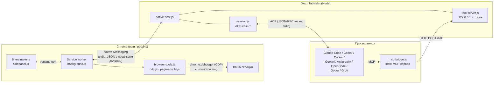
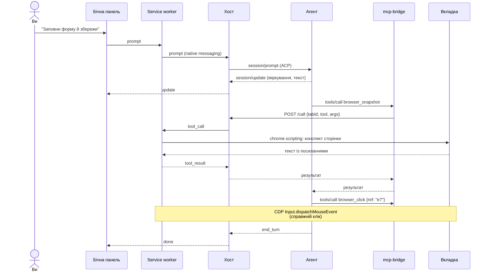
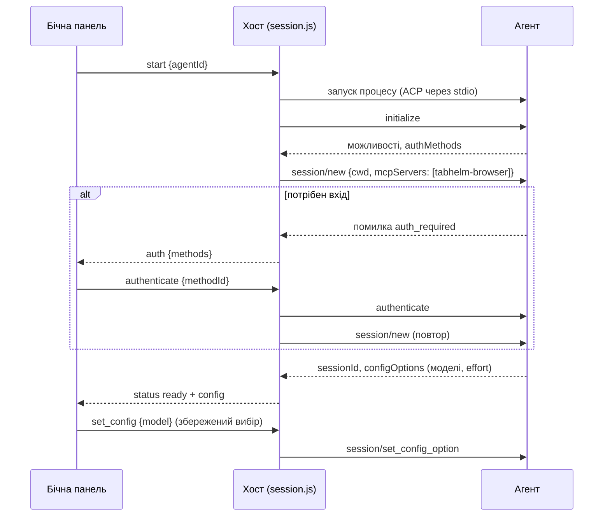
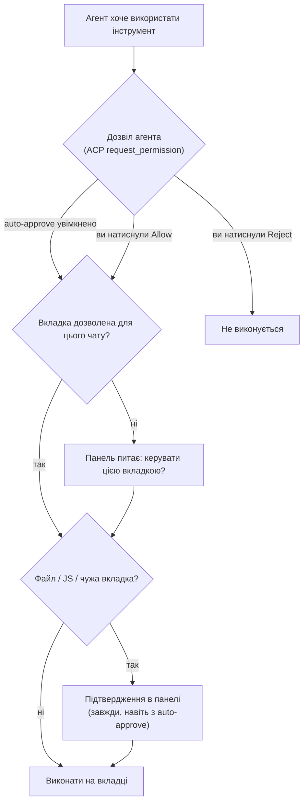

<p align="center"></p>

<h1 align="center">TabHelm</h1>

<p align="center">
  Бічна панель Chrome, через яку терміналні агенти керують вкладкою, що у вас перед очима.<br>
  <a href="README.md">English</a> · <b>Українська</b> · <a href="https://ivlad003.github.io/tabhelm/">Сайт</a>
</p>

Оберіть у бічній панелі **Claude Code, Codex, Cursor Agent CLI, Gemini CLI, Google Antigravity, OpenCode, Qoder CLI або Grok**, виберіть модель і опишіть завдання. Агент працює на вашому комп'ютері зі своїм логіном і читає, клікає та вводить текст на поточній вкладці вашого звичайного Chrome, де ви вже залогінені. Headless-браузер не потрібен.

## Зміст

- [Швидкий старт](#швидкий-старт)
- [Посібник користувача](#посібник-користувача)
- [Підтримувані агенти](#підтримувані-агенти)
- [Браузерні інструменти](#браузерні-інструменти)
- [Як це працює](#як-це-працює)
- [Огляд коду](#огляд-коду)
- [Розробка](#розробка)
- [Розв'язання проблем](#розвязання-проблем)
- [Відомі обмеження](#відомі-обмеження)

## Швидкий старт

**1. Встановлення** (Linux або macOS, Node.js 20+):

```bash
curl -fsSL https://ivlad003.github.io/tabhelm/install.sh | bash
```

Інсталятор завантажує останній реліз у `~/.tabhelm/app`, ставить залежності native host і реєструє його в Chrome, Chromium, Brave та Edge.

**2. Завантажте розширення.** Відкрийте `chrome://extensions`, увімкніть **Developer mode**, натисніть **Load unpacked** і виберіть `~/.tabhelm/app/extension`. Можна також завантажити [`tabhelm-extension.zip`](https://github.com/Ivlad003/tabhelm/releases/latest/download/tabhelm-extension.zip) із сайту й підключити розпаковану папку, але native host із кроку 1 потрібен однаково.

**3. Користуйтеся.** Натисніть іконку TabHelm на будь-якій сторінці → оберіть агента → **Connect** → напишіть завдання, наприклад *«Знайди найдешевший рейс на цій сторінці й відкрий його»*.

Щоб оновитися, запустіть команду встановлення ще раз.

## Посібник користувача

### Панель

| Елемент | Що робить |
|---|---|
| Список агентів + **Connect** | Запускає обраного агента для цієї вкладки. Невстановлені агенти показані неактивними, з підказкою, як їх встановити. |
| Модель + effort | З'являються після підключення. Список дає сам агент (ACP `configOptions`). Вибір запам'ятовується окремо для кожного агента. |
| **Controls: …** | Вкладка, з якою працює агент. Змінюється, якщо агент відкриває нову вкладку або перемикається. |
| Чат | Відповіді агента, згорнутий блок *Thinking*, план і журнал дій (`↳ Click "Save"`, `↳ Type "…" into "Email"`). |
| **Auto-approve actions** | Агент користується інструментами без запитів. Завантаження файлів, JavaScript та інші вкладки однаково потребують підтвердження (див. нижче). |
| **Send / Stop** | Надсилає повідомлення; поки агент працює, кнопка зупиняє його. |

### Підтвердження

Є два рівні:

1. **Дозволи агента.** Агент питає перед використанням інструмента (ACP `session/request_permission`). Ви відповідаєте його кнопками (*Allow once*, *Always allow*, *Reject*). **Auto-approve** відповідає за вас.
2. **Підтвердження TabHelm.** Показуються завжди, навіть з auto-approve: завантаження локальних файлів на сайт, виконання JavaScript на сторінці (`browser_evaluate`) і керування вкладкою, яку агент не відкривав сам.

### Вхід в акаунт

Якщо агенту потрібен вхід, панель покаже способи входу кнопками. Натисніть потрібну й завершіть вхід у вікні, що відкриється. Можна також один раз увійти в терміналі (`claude`, `codex login`, `agent login`…): TabHelm використовує власні облікові дані агента.

- **Google Antigravity** пропонує прямо в панелі *Log in with Google*, Gemini Enterprise, ключ Gemini API або Agent Platform.
- **Qoder CLI** використовує наявний вхід: один раз виконайте `qodercli login` (для агента, встановленого через `install-agent`: `~/.tabhelm/agents/qoder/node_modules/.bin/qodercli login`).

### Вкладки

Кожна вкладка має власну панель і власну сесію агента. За замовчуванням агент працює лише з нею. Він може відкривати нові вкладки у фоні (`browser_tabs` → `new`), а popup-вікна, відкриті сторінкою, додаються автоматично. Перемикання на будь-яку іншу вкладку потребує вашого дозволу.

## Підтримувані агенти

| Агент | Як запускається | Встановлення |
|---|---|---|
| Claude Code | `claude-agent-acp` (адаптер у комплекті) | [claude.com/claude-code](https://claude.com/claude-code) |
| Codex | `codex-acp` (адаптер у комплекті) | `npm i -g @openai/codex` |
| Cursor Agent CLI | `agent acp` (або `cursor-agent acp`) | `curl https://cursor.com/install -fsS \| bash` |
| Gemini CLI | `gemini --acp` | `npm i -g @google/gemini-cli` |
| Google Antigravity | ACP-сервер Google `agy_acp_server.par` | `npm run install-agent antigravity` (у `~/.tabhelm/app/host`) |
| OpenCode | `opencode acp` | `curl -fsSL https://opencode.ai/install \| bash` |
| Qoder CLI | `qodercli --acp` | `npm run install-agent qoder` або `curl -fsSL https://qoder.com/install \| bash` |
| Grok (експериментально) | `grok agent stdio` | з x.ai |

`npm run install-agent -- --list` показує всіх агентів з офіційного [реєстру ACP](https://agentclientprotocol.com). Агенти шукаються в `PATH`. Інсталятор запам'ятовує ваш `PATH`, бо Chrome запускає хост із мінімальним оточенням, тож після встановлення нового CLI запустіть інсталятор ще раз.

## Браузерні інструменти

Агент бачить 24 MCP-інструменти, усі прив'язані до вкладки чату:

| Група | Інструменти |
|---|---|
| Читання | `browser_snapshot`, `browser_find`, `browser_get_text`, `browser_screenshot` (видима частина / уся сторінка / елемент) |
| Миша | `browser_click` (ліва/права/середня кнопка, подвійний клік, модифікатори), `browser_click_xy`, `browser_hover`, `browser_drag` |
| Клавіатура й форми | `browser_type`, `browser_select_option`, `browser_press_key` (`Enter`, `F5`, `Control+A`…), `browser_upload_file`, `browser_scroll` |
| Навігація й вкладки | `browser_navigate`, `browser_go_back`, `browser_go_forward`, `browser_reload`, `browser_tabs` |
| Очікування й діалоги | `browser_wait`, `browser_handle_dialog` |
| Діагностика | `browser_console`, `browser_network`, `browser_evaluate` |

Знімок сторінки — це компактний текстовий конспект, у якому інтерактивні елементи мають посилання: `[e12] button "Save"` або `[f3:e5]` усередині iframe `f3`. Кліки й введення йдуть через Chrome DevTools Protocol (`Input.*`), тож сторінка отримує справжні (trusted) події, зокрема й у cross-origin iframe.

## Як це працює

### Компоненти



- **Розширення** відповідає за браузер: окрема бічна панель для кожної вкладки, service worker, що спілкується з хостом, і реалізація інструментів.
- **Хост** запускає сам Chrome через Native Messaging. Він спілкується з агентом за протоколом **ACP** і тримає локальний **tool server**.
- Хост передає агенту `mcp-bridge.js` як MCP-сервер у ACP `session/new`, тож жодного агента не треба налаштовувати вручну. Міст пересилає кожен виклик інструмента на tool server, а той — у розширення.

### Один запит від початку до кінця



### Запуск агента і вхід в акаунт



### Рівні безпеки



Tool server слухає лише `127.0.0.1`, відхиляє запити із заголовком `Origin` і вимагає випадковий токен, що генерується при кожному запуску. Тому ні вебсторінки, ні інші локальні процеси не можуть керувати браузером через нього. Перше повідомлення агенту нагадує, що вміст сторінок — недовірені дані, а перед незворотними діями треба питати користувача.

## Огляд коду

```
extension/                     розширення Chrome (Manifest V3, без збірки)
  manifest.json                дозволи; фіксований key → стабільний ID розширення
  background.js                service worker: панель на вкладку, native-порт, підтвердження
  browser-tools.js             диспетчер інструментів: ref, миша/клавіатура, вкладки, скриншоти, файли
  cdp.js                       сесії chrome.debugger; буфери діалогів, console, network, file chooser
  page-scripts.js              функції, що виконуються у фреймах: конспект, пошук, геометрія елементів
  sidepanel.html|css|js        чат, вибір моделі, підтвердження, журнал дій
host/                          native host (Node 20+)
  src/native-host.js           точка входу, яку запускає Chrome; маршрутизація повідомлень
  src/native-messaging.js      фрейми з 4-байтовою довжиною, захист від ліміту 1 MB
  src/session.js               одна ACP-сесія на вкладку: запуск, вхід, промпт, дозволи, налаштування
  src/agents.js                реєстр агентів, пошук у PATH, підказки для встановлення
  src/tool-server.js           локальний HTTP-ендпоінт із токеном
  src/mcp-bridge.js            stdio MCP-сервер, який запускають агенти (24 інструменти)
  scripts/install.js           реєстрація native host (Chrome, Chromium, Brave, Edge)
  scripts/install-agent.js     встановлення агентів із реєстру ACP
  scripts/smoke.js | e2e.js | tools-test.js | icons.js
scripts/build.js               збірка релізу → dist/
site/                          GitHub Pages: лендинг, install.sh, логотип
.github/workflows/             реліз за тегом, публікація Pages
docs/research.md               нотатки дослідження
```

## Розробка

```bash
git clone https://github.com/Ivlad003/tabhelm && cd tabhelm/host
npm install
npm run install-host           # зареєструвати хост для цієї копії
```

Підключіть `extension/` через Load unpacked. Після змін у розширенні натисніть ↻ на `chrome://extensions`; зміни в хості підхоплюються під час наступного Connect.

| Команда (у `host/`) | Що перевіряє |
|---|---|
| `npm run smoke -- claude` | хост + агент без Chrome (фейкова сторінка); будь-який id агента |
| `npm run test:tools` | кожен браузерний інструмент на тестовій сторінці в headless Chrome (46 перевірок) |
| `npm run e2e -- claude` | панель → агент → заповнення справжньої форми в headless Chrome |
| `E2E_MODEL=haiku npm run e2e -- claude` | те саме, плюс перемикання і відновлення моделі |
| `TABHELM_RELEASE=../dist/tabhelm-x.y.z npm run e2e -- claude` | зібраний реліз |

**Збірка:** `npm run build` (у корені репозиторію) створює `dist/`: розпакований реліз, `tabhelm-extension[-x.y.z].zip` і `tabhelm[-x.y.z].tar.gz` (без `node_modules`; адаптери Claude і Codex містять бінарники агентів, після встановлення це ~750 MB).

**Реліз:** підніміть `version` в `extension/manifest.json`, `host/package.json` і `package.json`, потім запуште тег `vX.Y.Z`. Workflow *Release* збере й опублікує файли, а *Pages* публікує `site/` при пуші в `main`.

Логи: `~/.tabhelm/host.log`. Агенти працюють у `~/.tabhelm/workspace`.

## Розв'язання проблем

| Симптом | Що зробити |
|---|---|
| У панелі «Host offline» | Запустіть інсталятор (або `npm run install-host`) ще раз і заново відкрийте панель. Перегляньте `~/.tabhelm/host.log`. |
| Встановлений агент показаний як «not installed» | Chrome запустив хост зі старим `PATH`. Запустіть інсталятор ще раз. |
| «Another debugger is attached» | Закрийте DevTools на цій вкладці. |
| «Chrome does not allow extensions to control …» | Сторінки `chrome://` і Chrome Web Store не можна автоматизувати. |
| Агент відповідає «Upgrade your plan» | Обраної моделі немає у вашому тарифі; виберіть іншу. |

## Відомі обмеження

- Поки агент працює, Chrome показує смугу «TabHelm налагоджує цей браузер». Прибрати її можна лише прапорцем `--silent-debugger-extension-api`.
- Вибір моделі в панелі передається агенту, і деякі агенти (наприклад, Cursor) зберігають його як свою глобальну модель за замовчуванням.
- Фонові вкладки можуть не рендеритися, тож скриншот там іноді не вдається.
- Позиція cross-origin iframe визначається за URL. Якщо iframe перейшов на іншу адресу, клік виконується через DOM, а hover і drag недоступні. Поле файлу всередині iframe не підтримується.
- Console і network збираються з моменту, коли агент уперше звернувся до вкладки.
- Якщо закрити панель, агент зупиняється, а історія чату не зберігається.
- Інсталятор підтримує Linux і macOS. У Chrome Web Store розширення ще не опубліковане: для магазину з manifest треба прибрати поле `key`.

TabHelm — незалежний проєкт, не пов'язаний із Google, Anthropic, OpenAI, Cursor, Qoder чи xAI.
